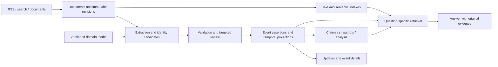

# Domain Monitor: outcome-led design review

Status: proposed design, not an implemented migration. Reviewed on 2026-11-18 at commit `9ca4a2e72a68680a1aec9298a3e5a693f49c455b`.

Implementation update: the first integrated ModelRelease slice is now implemented on `feat/event-memory-workflow`; see [WORKFLOW_IMPLEMENTATION.md](WORKFLOW_IMPLEMENTATION.md). This review retains the original audit findings and proposed wider roadmap. Its source line references describe the reviewed baseline, not the changed implementation.

This review uses the current code and offline synthetic replays. It does not establish the truth of live news, a measured production accuracy rate, or new end-to-end test results. Existing deployment and operational verification remain documented in `SPARK_DEPLOYMENT.md`.

## 1. Product outcome

Domain Monitor should help someone follow a research domain over time and answer four questions:

1. What materially changed since I last checked?
2. What is currently supported, disputed, or unknown?
3. Why might that change matter to my research question?
4. What evidence supported the answer, including what the system knew at an earlier time?

The unit of attention is a meaningful development or change. A document is an input and a source; a summary is a navigation and analysis aid. Neither should silently become the identity or authority of an event.

Success means fewer repeated stories, explicit changes, useful answers to specific questions, and short paths to original evidence. Article volume, generated text volume, and the number of retrieved nodes are operational measurements rather than measures of research quality.

Keep Topic as the research workspace. Preserve support for different domains; use **AI industry monitoring / ModelRelease** as the first bounded implementation and evaluation case, not as a permanent restriction on the product.

## 2. Valuable original decisions to preserve

| Existing decision | Value | Boundary to enforce |
| --- | --- | --- |
| Natural-language Research Brief becomes editable entities, angles, terms and sources | Makes monitoring accessible and keeps analysis aligned with the user's question | Separate search expansion, scope constraints, exclusions and ranking preferences |
| Cheap collection and local matching before bounded, batched AI enrichment | Controls recurring cost and makes continuous monitoring practical | Save source revisions first; selection controls computation and display, not evidence retention |
| Representative article plus alternative coverage | Produces compact reading surfaces without analyzing every duplicate | Representatives cannot replace contradictory or newly informative evidence |
| Claims, snapshots, deltas and long-term overview | Supports sustained research and change analysis beyond a news feed | Preserve distinct meanings for facts, analysis, report membership and business transitions |
| Structured current / evolution / archive retrieval and a cheap intent router | Gives time and lifecycle explicit treatment without a model planning call for every question | Every route must also be relevant to the actual question |
| Vector candidates are revalidated against SQLite | Prevents stale indexes from becoming authoritative | Apply the same rule to all indexes, caches and generated artifacts |
| Evidence adequacy gate and separate extraction / narration stages | Avoids generating an elaborate story from little change | Publish gates must check traceable support; writing diagnostics alone cannot establish support |
| Stable facts, append-only event history and recoverable attention policies | Supports correction, historical queries and selective attention without erasing facts | Keep factual state, evidence review and display attention independent |
| Local SQLite, disposable indexes, durable jobs and backup / restore tooling | Fits the present LAN deployment with manageable operating overhead | Preserve these operational capabilities while changing the knowledge workflow |

Evidence: `backend/pipeline.py:111`, `backend/relevance.py:504`, `backend/chatbot.py:150`, `backend/database.py:1263`, `backend/claim_lifecycle.py:133`, `backend/topic_summary.py:1976`, and `EVENT_MEMORY.md`.

## 3. Where the current shortcuts damage the result

Line references below refer to the reviewed commit.

| Priority | Observed behavior and code | Result a user can get | Required change |
| --- | --- | --- | --- |
| P0 | `topic_relevance` is copied into event `fact_confidence` and evidence `confidence`; source count determines `stabilized` (`backend/pipeline.py:651`, `:696`, `:761`) | A relevant comment or repeated report appears strongly substantiated | Separate relevance, evidence support, extraction quality, review and attention. Describe source counts without presenting them as truth probabilities |
| P0 | Snapshot set subtraction becomes `resolved_event_ids`, then a `resolved` transition (`backend/topic_summary.py:1204`, `:1589`) | An event displaced from a limited report appears to have ended | Report inclusion changes remain report changes. Business transitions require field assertions and evidence |
| P0 | Current-state retrieval receives only Topic; five nodes can suppress semantic retrieval (`backend/chatbot.py:162`, `:367`) | A busy Topic answers a specific entity question from unrelated recent material | Retrieve against the question, entities and time; assess relevant evidence coverage rather than total nodes |
| P0 | News ingestion and chat still use legacy state; the new event store is separate (`EVENT_MEMORY.md:21`) | Event history and the main workspace can describe different realities | Introduce one authority and one read interface per migrated Topic / event type |
| P1 | Short substrings and any word of a phrase can satisfy relevance (`backend/relevance.py:240`); AI relevance is not a final publication gate | `AI` inside `chair`, or `US` inside `Music`, admits unrelated material | Use language-aware term matching; keep scope rules separate; classify topicality and information gain before the Updates view |
| P1 | Event grouping and cross-run association depend heavily on titles; IDs derive from a seed title; single-source items do not create `events_v2` records (`backend/relevance.py:405`, `:441`; `backend/pipeline.py:402`, `:653`) | Different model versions merge, or an official single-source announcement lacks an event | Similarity proposes matches. Typed entities, versions, actions and dates constrain stable event identity. One source can create a visibly unreviewed event |
| P1 | Raw records are saved after URL and semantic dedup; source sets can be replaced; evidence IDs reuse event / array position (`backend/pipeline.py:943`, `:720`; `backend/database.py:768`, `:864`) | New runs lose provenance or overwrite what an old citation represented | Save immutable source revisions before filtering; append evidence links and explicit corrections |
| P1 | Article URL is globally unique and recent URL exclusion is global (`backend/database.py:59`, `:1757`; `backend/pipeline.py:976`) | The first Topic to collect a document prevents another Topic from using it | Store a global document revision once and maintain many-to-many Topic membership |
| P1 | Collectors provide varying amounts of source text; extraction truncates input; multi-source synthesis mainly sees titles (`backend/collectors/googlenews_collector.py:38`, `backend/collectors/rss_collector.py:33`, `backend/pipeline.py:161`, `:477`) | A search excerpt or incomplete text supports an apparently complete analysis | Record content completeness and locate supporting passages; missing information remains unknown |
| P1 | Chat exports context-level event / snapshot / overview sources; evidence sets contain generated claim summaries (`backend/chatbot.py:847`; `backend/pipeline.py:752`) | A citation opens another AI summary without locating support for the individual factual statement | Bind factual answer items to assertions and original source passages. Preserve analysis as analysis |
| P1 | Narrative grounding diagnostics use word overlap and generic-output checks can merely warn (`backend/topic_summary.py:2050`, `:2311`) | A polished report is marked final despite unsupported details | Keep writing diagnostics, add structural citation and value checks, and leave unsupported outputs provisional |
| P2 | Main feed loads articles; Research Brief defaults open; Chat replaces Analysis; Event Memory independently selects a Topic (`frontend/src/components/EventFeed.tsx:24`; `frontend/src/app/topic/[id]/page.tsx:47`, `:203`; `frontend/src/app/event-memory/page.tsx:134`) | Setup, reading, evidence and follow-up questions compete for context | Put Updates first, keep Sources and Briefing, and retain selected-event context while asking questions |

The URL normalizer does preserve YouTube's `v` parameter. The confirmed issue is broader: a comparison key should never overwrite the original URL; normalization can remove ports or meaningful parameters on other sites.

Five offline function replays were executed without external calls or database writes. The inputs and observed outputs are retained in [the audit replay record](artifacts/design-audit-replays.json):

| Synthetic replay | Observed result |
| --- | --- |
| Unrelated library / music headlines against `AI chips`, `Alibaba Qwen`, `US` | Both scored `0.3333` and passed the default relevance gate |
| Otherwise similar release headlines for Qwen 3.5 and 3.6 on successive days | Similarity `0.9796`; grouped into one cluster |
| Five unrelated current events, no fresh claims, ordinary current-state question | Vector supplement disabled |
| Snapshot membership changes from A to B while A remains active and no termination evidence exists | A enters `resolved_events`; the fallback produces `kind=resolved` |
| Original URLs containing a local port, `cid`, and a YouTube video identifier | Port and `cid` removed from comparison keys; YouTube `v` preserved |

These establish specific failure modes in the reviewed functions. They do not measure how often those failures occur in production.

## 4. Knowledge contract

### Sources and membership

- `Document` identifies a source resource; `DocumentRevision` stores original URL, resolved URL when available, publisher, publication time, fetched time, content hash and the exact retained text. Canonicalization keys are separate fields.
- Record whether text is a title, search excerpt, feed excerpt or full extracted body, plus capture failures. A source link alone is not proof that full text was read.
- `TopicDocument` records membership, relevance, exclusions and research angles independently of global storage. A document can serve several Topics.
- Preserve acquisition observations and duplicate / syndication relationships. Replaying the same revision is idempotent; identical text at several URLs does not become several independent confirmations.

### Identity, candidates and facts

- Reuse the event store's stable identity, immutable evidence, targeted corrections and valid-time / known-time projections. Domain validation belongs before authoritative writes.
- Entity IDs have types and aliases. Ambiguous names stay unresolved. A product family and its individual versions are distinct objects.
- For the first slice, event identity remains scoped to Topic, consistent with the existing store. Shared documents and entities do not require a cross-Topic event merge. Maintain an explicit stable binding from the existing numeric Topic ID to the event store's Topic key; renaming a Topic must not change identity.
- An extraction candidate contains source revision and passage offsets, model / prompt version, normalized field value, original wording, entity / event association, effective-time evidence and the proposed relation: new observation, additional support, transition, correction or conflict.
- Unknown effective time stays unresolved. Publication time and system insertion time cannot substitute for it. Preserve source date precision and timezone uncertainty instead of inventing an exact instant.
- Automatic observations require valid typed fields, a supporting passage and an operation allowed by the review policy. Link to an existing identity only when that association is unambiguous. A new event can receive a new stable ID automatically when the template's identity anchors are complete, no ambiguous existing match exists, and the configured source / validation policy permits it; it remains labelled machine only. For `ModelRelease`, those anchors include the developer and exact release version or another explicit release identifier. This allows an adequately supported single-source announcement to become visible without making every new event a manual task.
- Uncertain new identities, associations, conflicting values, corrections and transitions requiring review enter a focused queue. Pending candidates can appear in a clearly separated `Needs review` area, with no accepted-current-state claim. Never set `reviewed: true` merely to bypass the existing store's safeguards.
- A schema-valid value is not externally verified truth. Show its source and review status. Extraction failure remains `pending` or `failed`; default scores must not manufacture successful knowledge extraction.
- Retractions and partial-interval corrections need explicit semantics before automatic writes. Keep unsupported operations pending rather than emulating them through deletion or a new unlimited observation.

### Separate four kinds of state

| Dimension | Examples | What can change it |
| --- | --- | --- |
| Business state | Announced, Available, Withdrawn | Event-specific, evidenced field transitions |
| Evidence support | Unassessed, Supported, Contested, Withdrawn support | Source relationships and explicit corrections / retractions |
| Review state | Machine only, Needs review, Human reviewed | Validation and recorded review actions |
| Attention | Following, Pinned, Summary, Archived | User preference and explainable ranking policy |

A lack of recent reporting may lower attention or trigger a review reminder. It does not establish that an event ended or a previously supported fact became false. An agreed projection should be labelled consistently with its meaning, such as `No conflicting stored values`, rather than implying external verification.

### Analysis and disposable material

- Preserve forecasts, trends and hypotheses as analytical claims with supporting assertion IDs, assumptions, horizon and review dates. A `structural` label alone must not grant permanent factual validity.
- Generate snapshots and long-term analysis from a captured set of assertion / projection versions. Preserve original capture contents and scope.
- Separate `entered_report` / `left_report` from actual event transitions. Generate change cards from assertion differences, not report membership differences.
- Cache by input-version fingerprint, scope and generation configuration. A correction invalidates dependent current analysis; old captured reports remain historical artifacts with their original basis. Display pending refresh explicitly.
- Text indexes, vectors, generated Markdown indexes and current summary caches are disposable and rebuildable. Published historical reports, their retained content, generation configuration, input-version manifests and evidence relationships are durable records. Re-running a model is not a substitute for preserving the original report. Retrieve candidates from indexes and re-read the authoritative scoped version before answering.

## 5. Lightweight domain model

Expose **Settings → Domain Model** for advanced configuration, backed initially by versioned records or configuration rather than a dedicated graph infrastructure.

The minimum model manages entity types and aliases; event templates and participant roles; typed fields, units and enums; permitted state transitions; effective-time requirements; and validation / review rules. Published versions are immutable. Records bind to a specific version; changing a template does not reinterpret existing assertions.

The first template is `ModelRelease`: developer, model family, exact version / release identity, announcement or release date when evidenced, and availability state. An announcement and later general availability can belong to one release; a different model version is a separate release. Model names and dates alone do not justify an automatic merge. Later `PricingChange` support needs explicit currency, billing unit, input / output category, region and applicable offering before comparing prices.

Ordinary users choose what they want to monitor and review concrete ambiguities. Advanced users maintain templates and aliases. The review task should show **source passage → current value → proposed value → effective time → reason**. It must allow selecting an existing or creating a new entity / event, correcting a field or its time using evidence, and identifying the exact assertion a transition or correction would target. Accept, reject and defer actions are audited; missing time evidence can remain unresolved. Before acceptance, revalidate against the current assertion version and require a refreshed decision if the candidate has become stale. Aim to automate routine observations and concentrate review on consequential uncertainty.

## 6. Question-specific retrieval

Retain cheap deterministic routing and bounded context. Define the question scope once: Topic, selected event / entity, date range, `valid_at`, `known_at`, and current versus historical mode. Carry it through every candidate search and final read.

| User question | Primary path | Supporting path |
| --- | --- | --- |
| What is the current status of this release? | Entity / event lookup and current field projection | Supporting original passages and unresolved alternatives |
| What changed this week? | Assertion transitions and corrections in the requested interval | Captured briefings for explanation |
| What did we know on a particular day? | Known-by cutoff followed by valid-time reconstruction | Only evidence available by that cutoff; no current summaries |
| What do sources say about a broad issue? | Topic-scoped lexical and semantic passage candidates | Structured events / entities, deduplication and reranking |
| Why might this matter? | Relevant supported facts plus explicitly labelled analytical claims | Source material that supports or challenges the interpretation |

Judge adequacy by relevant entities, required fields, time coverage, contradictory evidence and actual supporting passages. Many unrelated nodes are inadequate. Exact identifiers and version numbers need lexical matching; natural-language descriptions benefit from semantic matching. Use relational joins for the small set of defined relationships; add more graph traversal only when an acceptance question requires it.

Web search is a bounded, clearly labelled gap-filling route when the question lacks adequate evidence and search is permitted. It cannot contaminate an answer about what the system knew in the past. An unresolved answer should explain the missing evidence instead of quietly answering a different question.

Answer facts cite assertion / evidence references. A citation opens the exact retained passage and revision, with publisher, original URL, publication time and capture time. The user should reach original support in at most two interactions. A valid citation ID is necessary but does not by itself establish that the passage entails the statement; evaluate that support separately.

## 7. Interaction design

- **Updates** is the default for an established Topic: New event, Field changed, Correction, Conflict and New independent evidence. Cards show the actual change, relevant date, why it is in scope, and a short labelled interpretation when useful. Reprints should not repeatedly reset the unread change count.
- **Briefing** preserves the original current analysis, long-term overview and evolution capabilities. Show scope, evidence cutoff, generated time and whether corrections have made the current briefing stale.
- **Sources** preserves the reading feed, alternatives, original URLs and collection status. Low-relevance or unprocessed material is discoverable here without becoming a prominent development.
- **Review** collects ambiguous identities, unsupported times, conflicting fields and proposed corrections. It is a targeted work queue rather than a demand to inspect every article.
- Selecting an update opens event facts, changes and evidence in one detail surface. Asking a follow-up preserves that selected object and time scope. Chat should not make evidence disappear.
- Research setup is prominent during onboarding and available later in settings. Keep current per-Topic persistence, cancellation, background jobs, SSE feedback and recovery behavior.
- Replace bare percentages with meaningful labels and explanations. Source priority, research relevance, support and review are different concepts. Sentiment / article-volume alerts remain optional media-coverage diagnostics; domain alerts should follow actual tracked changes or contradictions.
- Keep interface and generated prose in English. Preserve exact source quotations and original names, with translations visibly distinguished from quotations.

## 8. Migration and implementation order

### A. Make existing semantics safe and establish a replay baseline

Add fixtures for the observed failure modes. Correct misleading confidence / stability / resolved semantics, short-token matching, failed-enrichment state and question-specific adequacy. Document existing unsupported provenance rather than inventing past evidence. Keep the current operational deployment available.

### B. Build the source and candidate foundation

Persist document revisions before deduplication, introduce Topic membership, and add the versioned `ModelRelease` model and candidate queue. Reuse collectors, cheap similarity, representative selection, AI batching and usage ceilings behind these contracts.

Use an idempotent ingestion job / outbox boundary for writes crossing the source database and event store. A committed source revision can be retried after a worker restart. An event-store acknowledgement must precede a successful projection checkpoint. Index generation can lag and retry independently.

### C. Connect one complete Topic / event-type slice

Start with the existing AI monitoring Topic and `ModelRelease`. Run candidate matching in shadow mode first, compare with a reviewed replay set, then enable authoritative writes for this scope. After cutover, eventkb is the single writer for those facts. A scope-aware read adapter serves the same event IDs and temporal projection to cards, summaries and chat.

Retain legacy articles, snapshots and analytical claims as historical / derived material with explicit provenance. Legacy tables cannot independently overwrite migrated current fields. Unmigrated event types remain labelled legacy coverage until their own cutover. Avoid a period in which both stores are presented as authoritative current state for the same scope.

Historical import must preserve the distinction between source publication, documented source capture and authoritative assertion commit time. Keep the existing safe default: `assertion.recorded_at` is the server's actual authoritative write time. An old article's capture timestamp does not prove that a particular extracted field was known then and must not backdate a newly created assertion. Preserve legacy capture times separately. Restoring genuinely audited old assertions would require a separately specified controlled import process; ordinary ingestion and migration cannot bypass the current server-recorded known-time rule.

### D. Deliver Updates, evidence review and shared retrieval

Integrate event history into the Topic workspace, retain Briefing and Sources, bind answers to original evidence, and invalidate dependent current summaries after corrections. Keep the standalone Event Memory page useful as an advanced inspection surface while the primary workflow moves into Topic.

### E. Evaluate research usefulness and operational behavior separately

Use deterministic replay checks for identity, time, correction, isolation and recovery. Use a small fixed real-source corpus with source-supported expected fields and research questions for extraction, relevance and answer support. Report mistakes and denominators; model agreement is not a human gold label. Sampling and visible uncertainties should continue during real use.

## 9. Acceptance contract for the first slice

The following are proposed release gates, not current measured results:

| Scenario | Required result |
| --- | --- |
| Ten reports of the same release, including syndicated copies | One event; preserved source relationships; no tenfold independent-support claim |
| Similar titles announcing different model versions | Two release identities, including across successive collection runs |
| One official announcement with enough explicit information | A visible event with accurate source / review labels; no arbitrary two-source minimum |
| Announcement followed by availability | One event with an evidenced state transition and unchanged unrelated fields |
| Late old coverage | Adds historical support or a review candidate; cannot regress the current state merely because it was ingested later |
| A correction discovered later | Current reconstruction and historical known-by answers follow their respective evidence cutoffs; original assertion remains traceable |
| A report is displaced from a top-N snapshot or archived | No invented completed / resolved business transition |
| Many unrelated current events are added | The same specific question still finds its relevant event / passage |
| Same source belongs to two Topics, collected in either order | Both Topic memberships persist; source storage is shared; per-Topic retrieval stays isolated |
| Key field appears beyond the first 700 characters | Find and cite it, or explicitly state insufficient captured evidence |
| Extractor timeout or malformed response | Source remains available; extraction is pending / failed; no fabricated default facts |
| Conflicting sources or unknown effective time | Show unresolved alternatives / uncertainty; no confidence or recency shortcut selects truth |
| A factual answer gives a version, date or state | Each item reaches the supporting original passage and retained revision within two interactions |
| Worker crashes, index lags, or service restarts | Retry is idempotent; acknowledged facts persist; stale indexes cannot override authoritative scope / state |
| Backup is restored with current source and event stores | Identical selected projections and source-revision hashes; usable source navigation and scoped answers |

For the real-source evaluation, publish: main-feed relevance with numerator / denominator; duplicate splits and false merges separately; expected-field extraction coverage and errors; unsupported answer facts; original-passage citation coverage and sampled support correctness; exact temporal-question results; review workload; and AI / search cost per useful update. Measure time to find and verify a useful change with a user walkthrough. Set broader quality targets from that baseline rather than treating a handpicked passing demo as validated production accuracy.

## 10. Explicitly later work

Additional event templates, broader document upload and parsing, richer relation exploration, partial-interval corrections and retractions, model-assisted ambiguity resolution, and multi-user permissions can build on this first slice. Prioritize them when a concrete user question or operational requirement needs them. A large free-form ontology editor, general-purpose inference engine or a graph database is not a prerequisite for this design.
